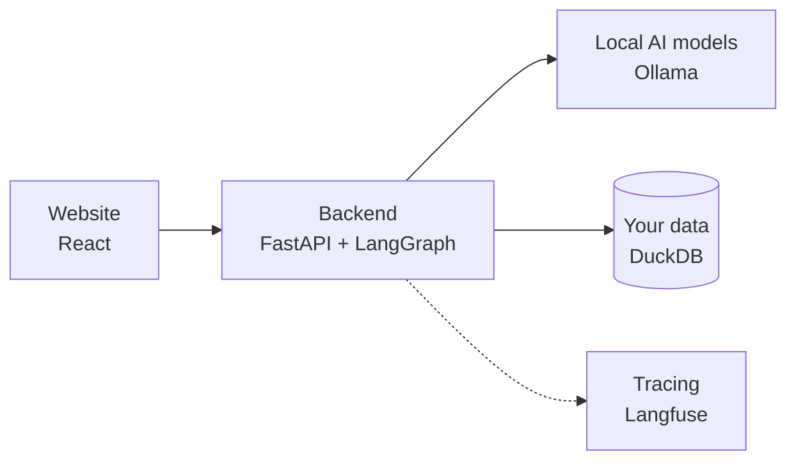
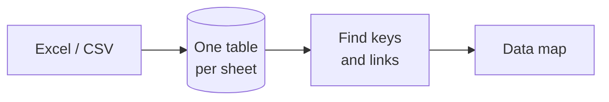
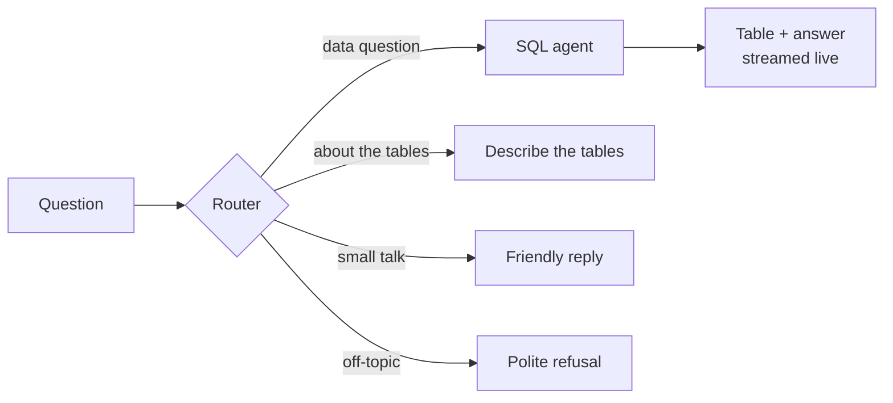
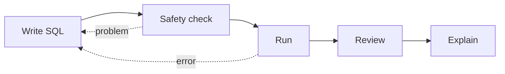
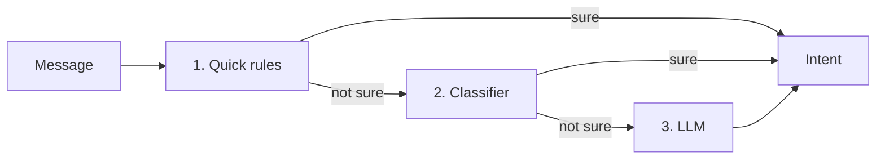
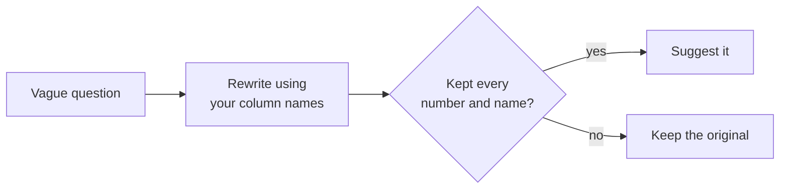
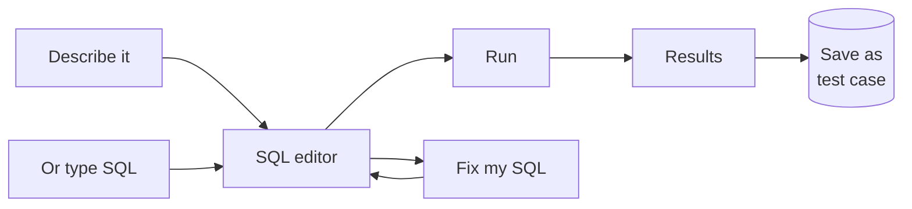
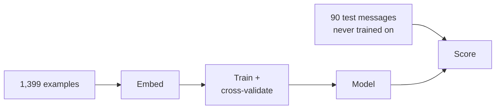
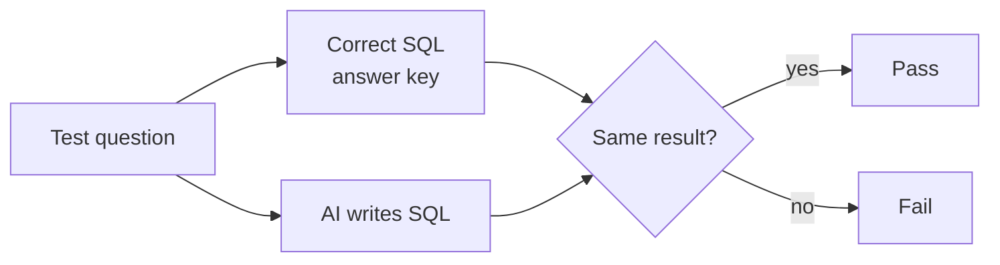
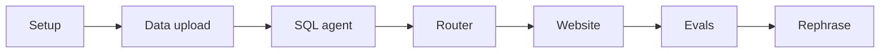

# TableTalk

**Chat with your spreadsheets.** Upload Excel or CSV files, see how your tables connect, and ask questions in plain English (or Hinglish). TableTalk writes the SQL, runs it, shows you the result, and explains it.

Everything runs on your own computer: local models through Ollama, no paid APIs, and no data leaves the machine.

## What it does

| Feature | What it does | How it works |
| --- | --- | --- |
| Upload | Excel or CSV, up to 5 tables, or one of 3 sample datasets (shop, bank fraud, school) | [diagram](#1-when-files-are-uploaded) |
| Data map | Interactive diagram of your tables and the links between them, found automatically | [diagram](#1-when-files-are-uploaded) |
| Ask | Plain English (or Hinglish) to SQL, with the result table and a streamed explanation | [diagram](#2-when-a-question-comes-in) |
| Smart routing | Chat, questions about the tables, data questions and off-topic each go their own way | [diagram](#3-inside-the-router) |
| Rephrase | Turns a vague question into a clear one using your real column names | [diagram](#4-rephrasing-a-vague-question) |
| Playground | AI writes SQL from a description, or you write it; "Fix my SQL" repairs it | [diagram](#5-the-playground) |
| Evals | Scores the router and the SQL agent on questions with known answers | [router](#how-the-classifier-was-trained) · [SQL](#how-the-sql-eval-scores-a-question) |

## How it works

### The big picture

Everything runs on your own machine.



### 1. When files are uploaded

Each sheet becomes a table, and links between tables are found by matching ID columns.



### 2. When a question comes in

The router decides what kind of message it is. Only data questions reach SQL.



**Inside the SQL agent.** If the check or the run fails, the error goes back to the model, up to 3 retries.



### 3. Inside the router

Cheapest first. The slow LLM is only asked when the first two layers aren't sure.



### 4. Rephrasing a vague question

A suggestion only: you choose whether to use it.



### 5. The playground

Write SQL yourself or let AI write it, then run, fix and save the good ones as test cases.



## Tech stack

| Part | Tools |
| --- | --- |
| Models | Ollama: Qwen2.5-Coder 7B (SQL), Llama 3.2 3B (routing fallback, rephrasing, explanations), nomic-embed-text (embeddings) |
| Agent | LangGraph, LangChain |
| Data | DuckDB, pandas, sqlglot |
| Router | scikit-learn logistic regression on embeddings |
| Backend | FastAPI, with streaming over Server-Sent Events |
| Frontend | React, Vite, React Flow + dagre, CodeMirror |
| Observability | Langfuse, self-hosted in Docker |
| Testing | pytest, plus custom eval scripts |

## How the classifier was trained

The router's middle layer is a **logistic regression** on **nomic-embed-text** embeddings. It sorts every message into one of 4 intents: `sql`, `dataset`, `small_talk`, `off_topic`.



| Step | Detail |
| --- | --- |
| Training data | 1,399 examples: templates, Qwen paraphrases and hand-written hard cases |
| Imbalance | `class_weight="balanced"` (sql has 3x more examples than small talk) |
| Validation | 5-fold `StratifiedGroupKFold`: a sentence and its paraphrases stay in the same fold, so scores aren't inflated |
| Tuning | Regularisation `C` picked automatically by cross-validated macro F1 |
| Test | 90 hand-written golden messages, never used for training |

| Result on the golden set | Before hard examples | After |
| --- | --- | --- |
| Accuracy | 90% | **99%** |
| Decided by the classifier at 0.8 confidence | 43 of 90 (all correct) | **83 of 90 (all correct)** |
| Sent to the slower LLM | 47 | **7** |

The threshold stays at 0.8: lowering it to 0.7 would save 2 LLM calls but let the one remaining mistake through.

## Making it reliable

**Safe by design**
- Only a single read-only `SELECT` runs. sqlglot rejects anything else before execution: writes, multiple statements, file-reading functions and unknown tables.
- The database connection is read-only, and results are capped, with the real total always shown.
- Rephrasing and SQL fixes are only ever *suggested*. The user clicks "Use this".

**Measured, not guessed**
- **Router eval:** 5-fold cross-validation, plus a hand-written golden set that is never used for training. Golden accuracy went from **90% to 99%**, and messages needing the slow LLM dropped from **47 to 7 out of 90**.
- **SQL eval:** execution accuracy runs the AI's SQL and a known-correct query, then compares the *results*, not the SQL text. It starts with 24 seed questions across the samples, plus any you save from the playground. It also runs as a Langfuse experiment, so runs can be compared side by side.
- **About 60 automated tests** cover uploads, schema inference, every blocked SQL pattern, the API, the eval matching rules and the rephrase safety check.

**Observable:** every step of every question is traced in Langfuse: route, SQL, retries, review and timing.

### How the SQL eval scores a question



## How we built it

Each step was working and tested before the next one started.



## Problems we solved

| Problem | Fix |
| --- | --- |
| Hinglish questions and "GDP of India" style questions were routed wrongly | Added 256 hand-written boundary examples, including Hinglish. Golden accuracy rose from 90% to 99%. |
| The classifier was right but rarely confident, so half the messages hit the slow LLM | Tuned regularisation automatically and picked the threshold from a sweep: 100% accurate at 0.8 |
| Paraphrased training data made test scores look better than they were | Grouped cross-validation keeps a sentence and its paraphrases in the same fold |
| Ollama's embedding server crashed on 1,100 sentences at once | Embedded in batches of 32 and cached the results, so retraining takes seconds |
| SQL and a question on the same line, where sqlglot read the question words as a table alias | Split on cheap cues first, then use an LLM split that sqlglot must confirm |
| Re-uploading the same file created duplicate sessions | Session IDs are a hash of the file contents, so the same files reopen the same session |
| Answers appeared all at once after a long wait | Streamed progress steps and the answer word by word |
| Big results flooded the page | Show the first 100 rows, count the real total and say clearly when rows are hidden |

## Run it

You need [Ollama](https://ollama.com), [uv](https://docs.astral.sh/uv/), Node.js and Docker.

```bash
# models
ollama pull qwen2.5-coder:7b && ollama pull llama3.2:3b && ollama pull nomic-embed-text

# Langfuse (optional, for tracing): clone langfuse/langfuse, then `docker compose up -d`,
# and put LANGFUSE_PUBLIC_KEY, LANGFUSE_SECRET_KEY and LANGFUSE_HOST in .env

# backend
uv sync
uv run python -m scripts.make_sample_datasets
uv run python -m app.agent.router train
uv run uvicorn app.main:app --reload

# frontend, in a second terminal
cd frontend && npm install && npm run dev
```

Open http://localhost:5173.

**Tests and evals**

```bash
uv run pytest
uv run python -m evals.run_sql_eval
uv run python -m evals.langfuse_eval
```

**Settings** (in `.env`):
- `TABLETALK_SQL_MODEL`, for example `qwen2.5-coder:14b` to compare models
- `TABLETALK_SMALL_MODEL`
- `TABLETALK_SESSION_DAYS`: how long unused uploads are kept (default 7, and 0 keeps them forever)

## Project layout

```
app/          backend: upload, schema, API
app/agent/    router, SQL agent, main graph, rephraser
frontend/     React website
evals/        SQL eval, Langfuse experiment, test cases
training/     router training data and golden test set
scripts/      sample data and training data generators
tests/        pytest suite
```

## What's next

The full project plan, with progress and future work, is in [docs/PROJECT_PLAN.md](docs/PROJECT_PLAN.md).


- Run the SQL eval on Qwen 7B vs 14B and record the results.
- Let users add, remove and fix links on the data map.
- Feed real questions from Langfuse back into the golden test set.
